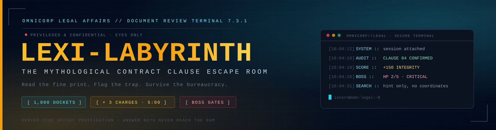
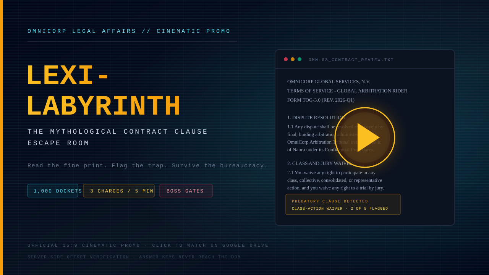
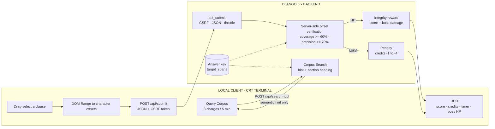

<div align="center">
  
  <h1>LEXI-LABYRINTH</h1>
  <p><strong>The Mythological Contract Clause Escape Room</strong></p>
  <p>
    
    
    
    
    
  </p>
  <p>
    <a href="#-quick-start">Quick Start</a> ·
    <a href="#-system-architecture--flowchart">Architecture</a> ·
    <a href="#-included-legal-files--dockets">Dockets</a> ·
    <a href="#-project-preview">Watch the promo</a>
  </p>
</div>

> **OMNICORP LEGAL AFFAIRS — ONBOARDING NOTICE**
>
> The contract is 4,000 words. The clause is one sentence. Your review window is seven minutes.
> Your compliance credits are finite. The exit is on the other side of the fine print.

---

## 🕳️ Purpose & Vision

**Lexi-Labyrinth** is a browser-based contract-review game disguised as a dystopian enterprise document terminal. You play an unpaid intern at **OmniCorp Legal Affairs**, trapped in a labyrinth of terms of service, master services agreements, data-processing addenda, and arbitration riders. Your only weapons are a cursor, a red pen, and a shrinking pool of **Compliance Credits**.

Every level is a dense legal instrument rendered in a CRT-styled reader. Somewhere inside the boilerplate are **predatory clauses**: evergreen renewals that never end, indemnities that make you insure the other side's negligence, arbitration clauses that relocate justice to a Pacific island, and liability caps measured in postage stamps. Drag-select a clause, flag it, and the server tells you whether you found a trap — or bought the company another coffee with your own credits.

The vision is simple: **make reading the fine print feel like a boss fight**. Not a quiz with a highlighted answer key, not a checklist of definitions, but a tense, tactile review where the document is the dungeon, the clause is the monster, and the terminal is watching.

> The game never sends the answer key to your browser. You cannot inspect-element your way out of the Labyrinth.

---

## 💼 Why It Matters / Developer Value

Contracts are code, and most people execute them without reading the source. Lexi-Labyrinth turns that uncomfortable truth into a training loop that is genuinely fun to replay.

| Audience | What the game trains | Real-world clause it mirrors |
|---|---|---|
| **Lawyers & paralegals** | Issue-spotting under time pressure; triaging dense instruments; explaining risk in plain language | Evergreen renewal, uncapped indemnity, unilateral fee escalation, forced arbitration |
| **Developers & designers** | Building anti-cheat validation without leaking answers; mapping DOM selections to server offsets; rate-limited, server-authoritative game state | Terms of service, API terms, data-processing addenda |
| **Everyday users** | Recognising the patterns that cost money: auto-renewal windows, one-way liability, class-action waivers, perpetual data licences | The "I agree" screen we all click |

### Developer value

This is also a compact reference implementation of a few ideas that are easy to describe and hard to get right:

- **Server-side answer validation.** The client submits character offsets; the server owns the clause coordinates and never serialises unsolved targets.
- **Fuzzy human selections, strict machine checks.** A hit requires **≥ 60% coverage** of a clause and **≥ 70% precision** inside it, so neither single-character fishing nor whole-document sweeps score.
- **Deterministic procedural content.** Level 847 generates the same contract and answer key on every machine, with no hand-maintained offsets.
- **Anti-abuse defaults.** CSRF on every mutation, JSON-only endpoints, bounded payloads, salted IP hashes, and layered rate limits with `Retry-After`.
- **A test suite that asserts the absence of leaks**, not just the happy path: 47 tests, including no-answer-key checks on pages, failures, and hints.

---

## ⚙️ Key Features

### ♾️ 1,000-Level Endless Docket

Three hand-authored story dockets plus **997 procedurally generated instruments** (levels 4–1000). Every level is derived from its number alone, so the text, clause count, and answer key are stable across machines and re-seeds.

| Levels | Tier | What changes |
|---|---|---|
| 1–250 | **Common** | Ordinary boilerplate; ordinary traps |
| 251–500 | **Complex** | Cross-referencing schedules and layered definitions |
| 501–750 | **Dystopian** | Openly one-sided instruments |
| 751–1000 | **Mythological** | Pantheons, memories, and perpetuity clauses |

Archetypes rotate **corporate → cybernetic → mythological → bureaucratic**. Difficulty scales from tier 1 to 5, review windows tighten from 420 s toward 240 s, and base penalties climb from 1 to 4 credits. The campaign completes only at level 1000.

### ⌕ Temporal Legal Search Tool

The **Corpus Query** panel is a tactical hint system with a cost:

- **3 charges**, tracked server-side per session.
- Spending the last charge starts a **5-minute full recharge**; the HUD shows a live `MM:SS` countdown and disables the button.
- Each query returns a **semantic hint** and the **section heading** of the first unsolved clause — never its character offsets, exact text, or clause index.
- No charge is spent when every clause is already solved.
- Rate-limited separately from submissions; recharging returns `429` with `Retry-After`.

The UI reads `[ ⌕ QUERY CORPUS [ 2 / 3 USES ] ]` and narrates every query into the terminal as a corporate archive event.

### 👔 Boss Gate Mechanics

Every **third level** is a bureaucratic boss encounter. The document grows to five clauses, the threat meter hits **CRITICAL**, and rejections cost an extra **+2 Compliance Credits**.

- Boss HP equals the number of unflagged clauses; each confirmed clause removes one gate.
- The HP bar reacts with a damage shake, while the terminal announces the boss's displeasure.
- Bosses include **The Compliance Director** (Director of Jurisdictional Affairs), **The Archivist Prime**, **The Chief Synod**, and **The Oracle of Risk**.
- Defeating a boss can complete the *Break a Gate* daily task and unlocks the next tier of the Labyrinth.

### 📅 Daily Tasks & Compliance Credit Payouts

Three tasks roll over per calendar day, generated deterministically and tracked per player:

| Task | Objective | Reward |
|---|---|---|
| **File Four Flags** | Confirm 4 clauses today | +1 credit |
| **Mass Filing** | Confirm 6 clauses today | +2 credits |
| **Break a Gate** | Defeat a bureaucratic boss | +2 credits |
| **Clean Docket** | Clear a level with zero rejected flags | +3 credits |
| **Three in a Row** | Reach a 3-flag confirmation streak | +1 credit |

Progress is recorded on clause hits, boss defeats, clean clears, and streaks. Rewards are claimed **once** from the Daily Tasks modal; credits are capped at 12 and every payout is logged.

### 🖥️ The Rest of the Terminal

- **CRT interface** — scanlines, vignette, amber/cyan highlights, flicker, and a live threat indicator.
- **Document reader** — serif contract text, persistent highlights for confirmed clauses, floating `⚑ FLAG CLAUSE` toolbar.
- **Server-authoritative clock** — pause the JavaScript, and the review window still expires.
- **Dystopian logging** — every rejection, recharge, reward, and deadline breach prints into the terminal.
- **Audit trail** — `SubmissionLog` records every attempt with verdict, range, credit delta, and a salted IP hash.

---

## 🎥 Project Preview

<div align="center">
  <a href="https://drive.google.com/file/d/1silALWbcTVn3PjAL7WyVFwCQViSby0CS/view?usp=sharing" title="Watch the Lexi-Labyrinth 16:9 cinematic promo">
    
  </a>
  <p>
    <a href="https://drive.google.com/file/d/1silALWbcTVn3PjAL7WyVFwCQViSby0CS/view?usp=sharing">
      <strong>▶ Watch the official 16:9 cinematic promo on Google Drive</strong>
    </a>
  </p>
  <sub>GitHub sanitises inline <code>&lt;video&gt;</code> tags, so the poster opens the full promo.</sub>
</div>

> If your browser blocks inline Drive playback, use the link below the player — the full promo is publicly available.

---

## 🧭 System Architecture & Flowchart

Lexi-Labyrinth is a deliberately thin client over a suspiciously well-defended Django backend. The client may draw the document, but it never owns the truth.



### The validation cycle, step by step

1. **Local client.** A drag selection becomes a half-open character range over the document's text nodes. The page sends only `{start, end}` — never the selected string, and never the answer.
2. **Django 5.x backend.** `api_submit` enforces POST + CSRF + JSON, clamps the range to the document, throttles the session, and locks the player row inside a transaction.
3. **Corpus search.** A separate endpoint spends a Search Tool charge, selects the first *unsolved* clause server-side, and returns a hint plus its section heading. It is deliberately incapable of returning coordinates.
4. **Server-side offset verification.** The submitted range is compared with `ContractPuzzle.target_spans` using coverage and precision gates. Unsolved coordinates never enter the page, the JSON, or the failure copy.
5. **Integrity reward (or penalty).** A hit scores `100 × difficulty_tier + time bonus + boss bonus`, damages the boss gate, records progress toward daily tasks, and returns only the solved span offsets needed to paint highlights. A miss deducts credits, resets the streak, and prints a corporate thank-you note.

### Why this matters

| Threat | Defence |
|---|---|
| Inspect-element answer hunting | Answer key never serialised to the client |
| One-character brute force | 12-character minimum, 60% coverage, 70% precision |
| Whole-document sweep | Precision gate rejects selections mostly outside a clause |
| CSRF / cross-site posting | CSRF token via meta tag + HttpOnly cookie; POST-only endpoints |
| Request flooding | Sliding-window limits + lockouts on submit, advance, reset, search, claims |
| Clock tampering | Database-owned `level_started_at`; server computes remaining time |
| Payload abuse | 4 KB JSON cap, strict integer/bounds validation, `no-store` responses |
| Answer leakage in hints | Hint text + section only; no offsets, indices, or clause text |

---

## 📜 Included Legal Files & Dockets

The campaign opens with three fully authored instruments. Each is a fictional OmniCorp contract, but every trap is modelled on a real drafting pattern.

| Docket | Level | Clauses | Review window | Penalty / miss | Boss |
|---|---:|---:|---:|---:|---|
| **The Renewal Corridor** | 1 | 4 | 420 s | 1 credit | — |
| **The Indemnity Abyss** | 2 | 4 | 480 s | 1 credit | — |
| **The Jurisdiction Labyrinth** | 3 | 5 | 540 s | 2 + 2 credits | **The Compliance Director** |

### 01 · The Renewal Corridor — *Automatic Renewal & Perpetuity Traps*

A master services agreement that renews itself for 24 months at a time and treats silence as consent. Four clauses to sever:

- Evergreen 24-month auto-renewal with a 90-day written-notice window
- Unilateral 18% renewal escalation with deemed acceptance
- Perpetual, universe-wide assignment of all feedback and derivative works
- Immediate suspension for unspecified "reputational risk" with no liability

> "This Agreement shall automatically renew for successive additional terms of twenty-four (24) months each unless Client delivers written notice of non-renewal to Provider not less than ninety (90) days prior to the end of the then-current term."

### 02 · The Indemnity Abyss — *Disproportionate Liability Shifts*

A data-processing addendum where risk flows uphill. Four clauses, including an unlimited indemnity that covers the provider's own negligence, a settlement right exercised without consent, and this:

> "Provider's aggregate liability arising out of this Addendum shall not exceed one hundred United States dollars (US$100), whether the claim sounds in contract, tort, or statute."

### 03 · The Jurisdiction Labyrinth — *Mandatory Arbitration & Waived Class-Action Rights*

The boss docket. Five clauses route every grievance into a confidential tribunal in the Republic of Nauru, make the claimant pay all fees, gag disclosure to regulators, and preserve asymmetric injunctive relief for the provider alone.

> "You waive any right to participate in any class, collective, consolidated, or representative action, and you waive any right to a trial by jury in any forum."

**Boss:** The Compliance Director, Director of Jurisdictional Affairs. Five HP gates. Wrong flags cost double. The only way out is to read the rider.

### 04–1000 · Endless Dockets

Procedurally generated across corporate, cybernetic, mythological, and bureaucratic archetypes, with 4 clauses per standard level and 5 per boss gate. The generator reuses a curated clause bank but varies parties, durations, percentages, seats, and fees, so no two dockets read identically.

---

## 🚀 Quick Start

### Prerequisites

- **Python 3.11+**
- **Django 5.0+** (installed via `requirements.txt`)
- A modern browser
- Optional: Node.js 18+ for the compiled Tailwind build

### Installation

```powershell
git clone https://github.com/saviochackoxavier-tech/lexi-labyrinth.git
cd lexi-labyrinth

python -m venv .venv
.venv\Scripts\Activate.ps1        # Windows
# source .venv/bin/activate       # macOS / Linux

pip install -r requirements.txt

copy .env.example .env            # Windows
# cp .env.example .env            # macOS / Linux
```

### Initialise the Labyrinth

```powershell
python manage.py migrate
python manage.py seed_game --fresh
python manage.py seed_endless --to 1000   # optional: pre-warm all 997 procedural levels
python manage.py runserver
```

Open **http://127.0.0.1:8000/**.

Optional admin access to the clause registry:

```powershell
python manage.py createsuperuser
# visit /admin/
```

### Environment variables

| Variable | Default | Purpose |
|---|---|---|
| `DEBUG` | `1` | `0` enables HTTPS redirect, secure cookies, HSTS |
| `SECRET_KEY` | dev-only key | **Required in production**; signs sessions and CSRF |
| `ALLOWED_HOSTS` | `localhost,127.0.0.1,[::1]` | Comma-separated hostnames |
| `CSRF_TRUSTED_ORIGINS` | empty | E.g. `https://lexi.example.com` |
| `TAILWIND_CDN` | `1` | `0` loads compiled `static/css/tailwind.css` |

---

## 🔐 Security Model

| Layer | Implementation |
|---|---|
| **Answer key** | `ContractPuzzle.target_spans` lives only in the database; unsolved offsets are never serialised |
| **Selections** | Minimum 12 chars, ≥ 60% coverage, ≥ 70% precision; server-side only |
| **CSRF** | Token delivered via `<meta>`; cookie remains `HttpOnly`; every mutation is POST-only |
| **Rate limits** | Submit 18/min → 45 s lockout; search 10/min; claims 12/min; reset 3/min |
| **Clock** | Server-owned deadline; expiry charges one credit exactly once |
| **Transport** | CSP, `X-Frame-Options: DENY`, `nosniff`, `Referrer-Policy: no-referrer`, COOP |
| **Payloads** | JSON-only, 4 KB cap, strict integer/range validation, `no-store` responses |
| **Audit** | `SubmissionLog` with verdict, offsets, credit delta, salted IP hash |

> The answer key is the family silver. It never leaves the server.

---

## 🧪 Test Suite

```powershell
python manage.py test core -v 2
```

**47 tests, all passing** (≈2.5 s). Coverage includes:

- seed integrity, clause bounds, non-overlap, and idempotent re-seeding;
- procedural determinism, tier bands, offset validity, boss cadence, and archetype rotation across levels 4–1000;
- lazy generation and advancement into Endless Mode;
- matching gates at their exact coverage/precision boundaries;
- hit / miss / duplicate flows and score accounting;
- boss surcharge, HP depletion, and game-over;
- Search Tool charge budget, 5-minute recharge, no-charge-on-solved, and hint secrecy;
- daily challenge creation, rollover, progress, and claim-once payouts;
- CSRF rejection/acceptance, rate-limit lockouts, and clock expiry;
- no-answer-key assertions on pages, state, failure, and hint responses.

---

## 🗂️ Project Structure

```text
lexi-labyrinth/
├─ assets/
│  └─ banner.svg                  # README banner (this file's artwork)
├─ lexi_labyrinth/
│  ├─ settings.py                 # hardened defaults, env parsing
│  └─ urls.py
├─ core/
│  ├─ models.py                   # puzzles, sessions, solves, logs, tool state, challenges
│  ├─ views.py                    # game room + 7 JSON endpoints
│  ├─ utils.py                    # matching gates, throttling, hint helpers, terminal events
│  ├─ procedural.py               # deterministic Endless generator (levels 4–1000)
│  ├─ challenges.py               # daily selection, progress, payouts
│  ├─ middleware.py               # CSP / privacy headers
│  ├─ tests.py                    # 47 tests
│  └─ management/commands/
│     ├─ seed_game.py             # hand-authored levels 1–3
│     └─ seed_endless.py          # pre-warm levels 4–1000
├─ templates/
│  ├─ base.html
│  └─ game_room.html              # HUD, document reader, terminal, modals
├─ static/
│  ├─ css/app.css                 # CRT scanlines, terminal tones, highlights
│  └─ js/document_viewer.js       # selection offsets, fetch, HUD, tools, daily tasks
├─ static_src/input.css
├─ tailwind.config.js
├─ package.json
├─ README.md
└─ LICENSE
```

### API surface

| Method | Path | Purpose |
|---|---|---|
| `GET` | `/` | Game room, contract, HUD, solved highlights |
| `GET` | `/api/state/` | Authoritative resync: credits, timer, boss, tool, challenges |
| `POST` | `/api/submit/` | Validate `{start, end}` selection |
| `POST` | `/api/advance/` | Advance once every clause is flagged |
| `POST` | `/api/reset/` | Purge the run and reopen level 1 |
| `POST` | `/api/search-tool/` | Spend a charge for a non-leaking hint |
| `GET` | `/api/challenges/` | Today's tasks and progress |
| `POST` | `/api/challenges/claim/` | Claim a completed task's credits |

---

## 🗺️ Roadmap

- [x] Three authored dockets with boss gate
- [x] 1,000-level deterministic Endless Mode
- [x] Server-side offset validation with coverage/precision gates
- [x] Search Tool with charges and cooldown
- [x] Daily tasks, credit payouts, and claim-once ledger
- [x] 47-test suite including leak assertions
- [ ] PostgreSQL + Redis deployment profile
- [ ] Additional clause banks and languages
- [ ] Replay/ghost mode with per-clause timings
- [ ] Accessibility pass for keyboard-only clause selection

---

## 📄 License

Released under the **MIT License** — see [LICENSE](LICENSE).

The contracts, companies, tribunals, and pantheons in this repository are fictional. Any resemblance to your actual terms of service is a design feature, not a coincidence.

<div align="center">
  <sub>Built with Django, Tailwind, caffeine, and a deep suspicion of the phrase "including without limitation".</sub>
  <br /><br />
  <a href="https://github.com/saviochackoxavier-tech/lexi-labyrinth">github.com/saviochackoxavier-tech/lexi-labyrinth</a>
</div>
